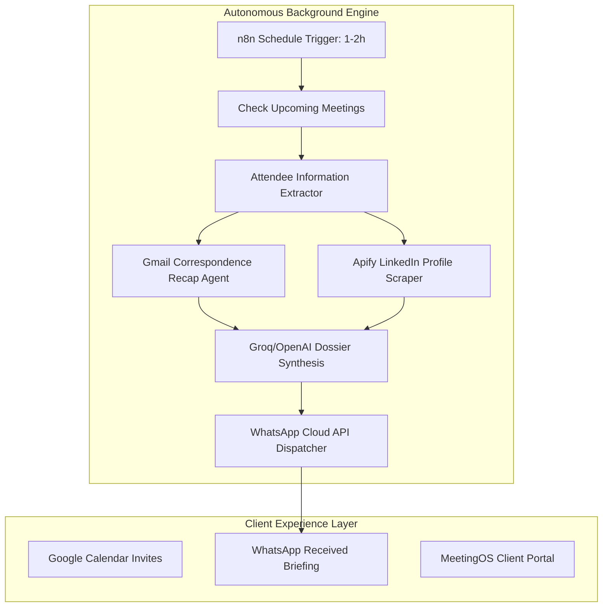

# System Architecture: AI Meeting Prepration automation
*Engineered by nayva tech industries*

## Executive Overview
The AI Meeting Prepration automation architecture strictly decouples the client-facing presentation and credential intake layer from the autonomous backend execution layer.

## Architectural Decoupling Principles
1. **Client Isolation**: The client never interacts with n8n canvas, nodes, or execution trees.
2. **Autonomous Scheduling**: The workflow executes on an automated 1–2 hour timer.
3. **Multi-Agent Research**: Uses LangChain LLM chains for semantic parsing and Apify for deep LinkedIn scraping.
